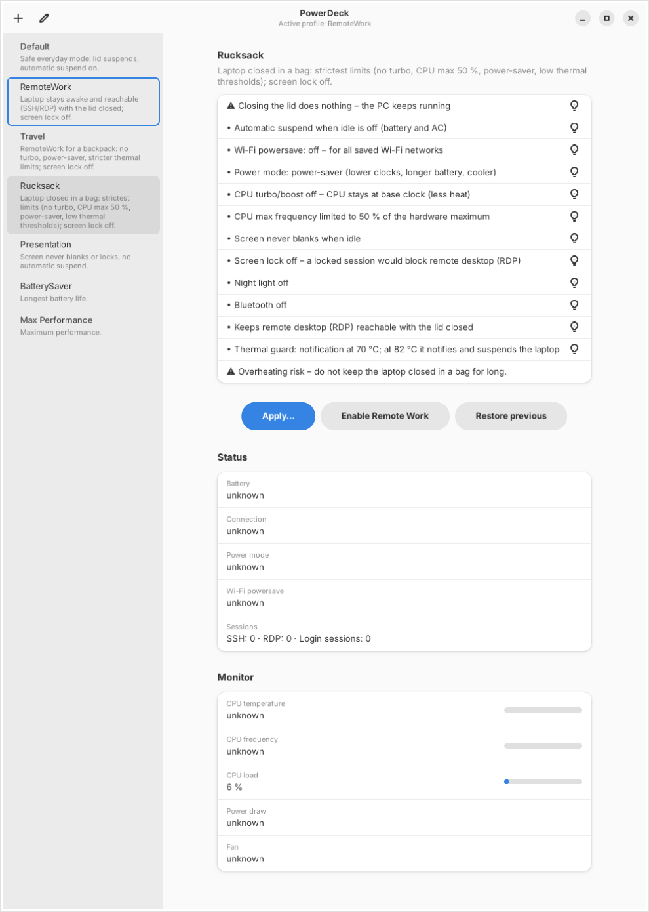

# PowerDeck

Linux workstation profiles for Ubuntu/GNOME. See [SPECIFICATION.md](SPECIFICATION.md).



*RemoteWork is the active profile (accent frame in the list and in the title bar), Rucksack is selected and its contents are shown. Rendered headless without sensors, so status values read “unknown”. Slovak UI: [docs/screenshot-sk.png](docs/screenshot-sk.png). Regenerate with `xvfb-run -a python3 scripts/screenshot.py docs/screenshot.png --active RemoteWork --select Rucksack`.*

See also [future_improvements.md](future_improvements.md) (how to work more efficiently next time).

## Status (v1.0 – in daily use on a ThinkPad T14s Gen 4)

Profiles for lid, auto-suspend, Wi‑Fi powersave, tethering priority, power mode, display timers/brightness/night light, Bluetooth, CPU limits and a temperature-regulated CPU power limit (Rucksack), whitelisted user-service tasks; thermal/battery guard that starts with the session (suspends on sustained overheating or at 15 % battery with the lid ignored, keeps RDP reachable); GTK4 app with profile editor and a top-bar icon; CLI; `.deb` build. See [TODO.md](TODO.md) for what is left and the real-hardware checklist.

## Requirements and compatibility

Tested on **Ubuntu 26.04 with GNOME** (ThinkPad T14s Gen 4, Intel) and in an Ubuntu VM; other systems are untested. The `.deb` is for Debian/Ubuntu.

| Needs | For | Notes |
|---|---|---|
| systemd + logind, polkit (`pkexec`) | lid, suspend, admin changes | almost every distribution |
| NetworkManager | Wi‑Fi powersave, tethering | |
| power-profiles-daemon (`powerprofilesctl`) | power mode | Fedora 41+ ships tuned-ppd instead (untested) |
| GNOME | idle/lock/display settings, desktop sharing (RDP), the guard's screensaver handling, top-bar icon (AppIndicator extension) | on KDE/Xfce only lid, Wi‑Fi and power mode would work |
| Python 3.11+, GTK 4.10+, libadwaita 1.5+ | the app | Ubuntu 24.04+, Debian 13+, Fedora 40+ (not Debian 12) |
| CPU | turbo: Intel and AMD; temperature regulation: RAPL power limits (Intel), otherwise the max-frequency cap | |

## Licence

GPL-3.0-or-later, see [LICENSE](LICENSE).

## Install admin helper (needed for lid settings)

```bash
sudo scripts/install-helper.sh            # remove with: sudo scripts/install-helper.sh --uninstall
```

Installs a root-owned `/usr/libexec/powerdeck-helper` and a polkit policy. The helper can only write/remove one logind drop-in with whitelisted values.

## Build a .deb

```bash
scripts/build-deb.sh && sudo apt install ./dist/powerdeck_*.deb   # installs app, helper, polkit policy, desktop entry
```

## Uninstall

`sudo apt remove powerdeck` (or `sudo scripts/install-helper.sh --uninstall`) first puts every setting back the way it was before PowerDeck (`powerdeck reset-all` for each user), stops the guard, then removes the files.

## Run

```bash
sudo apt install python3-gi gir1.2-gtk-4.0 gir1.2-adw-1
python3 -m powerdeck.gtk_app        # GUI
python3 -m powerdeck.cli monitor --csv out.csv --duration 60   # temperature/frequency/load/power log
python3 -m powerdeck.cli list       # CLI: list | status | plan NAME | apply NAME | restore | snapshot | guard
pytest                              # tests (fake system, no root needed)
```

## Develop in a container (no admin password)

```bash
scripts/dev-container.sh build   # once: Ubuntu 26.04 image with GTK, polkit, gsettings schemas
scripts/dev-container.sh all     # pytest, .deb build/install/remove, headless GUI screenshot (dist/)
scripts/dev-container.sh shell   # root shell inside the container
```

Rootless podman: the repository is mounted read-only, `/sys` is read-only and there is no network, so nothing on the host changes. The container cannot test what needs a real GNOME session or hardware (lid, screensaver/RDP, CPU limits, thermal, battery) – use a VM or the laptop for that.

## Test in a VM (GNOME, systemd, lid – no admin password)

```bash
scripts/dev-vm.sh create         # once: Ubuntu 26.04 cloud image + GNOME (~860 MB download, ~4 GB disk)
scripts/dev-vm.sh start          # headless QEMU/KVM in the background (needs the kvm group)
scripts/dev-vm.sh test           # copy the working tree, pytest, build + install the .deb in the VM
scripts/dev-vm.sh lid close      # simulated lid switch (uinput SW_LID); "lid open" also wakes it from suspend
scripts/dev-vm.sh ssh            # shell as "dev" (passwordless sudo and polkit – VM only)
scripts/dev-vm.sh stop
```

The VM runs a real GNOME 50 Wayland session (auto-login), logind, polkit and systemd user services, so `pkexec`, the lid drop-in, the guard service and `apt remove` can be tested end to end. Limits: QEMU's display is a `Virtual` connector, which GNOME treats as an external monitor – gsd-power then blocks the lid switch itself, so the "lid closed → screensaver → RDP drops" path only happens on a real laptop (stop GNOME with `sudo systemctl isolate multi-user.target` to test logind alone). No battery, turbo or real Wi-Fi. After a suspend/resume the virtio GPU can hang the guest when GNOME restarts; then `kill` QEMU (`~/.local/share/powerdeck-vm/qemu.pid`) and `start` again.

## Remote desktop with the lid closed

GNOME activates its screensaver when the lid closes (it does so instead of suspending, e.g. while an app such as Claude Desktop blocks suspend), and an active screensaver – locked or not – closes all **desktop sharing** RDP sessions and refuses new ones. Two ways around it:

- **Desktop sharing (your running session):** the `RemoteWork`, `Travel` and `Rucksack` profiles turn the screen lock and idle blanking off, and the guard dismisses the screensaver the moment it appears. The guard must run: `systemctl --user enable --now powerdeck-guard` (installed by the `.deb`), or `python3 -m powerdeck.cli guard` from the repository. The RDP connection still drops once when the lid closes, but you can reconnect right away. While one of these profiles is active, anyone who opens the lid gets an unlocked desktop.
- **Desktop sharing is the tested way** (Ubuntu 26.04, ThinkPad T14s, 2026-11-16): connecting with the lid closed works and holds; a running connection drops once when the lid closes and reconnecting works right away. Gnome-shell closes the connection about 2 s before it reports the screensaver, so the guard can only recover, not prevent that drop.
- **Remote Login** (a separate headless GNOME session, *Settings → System → Remote Desktop → Remote Login*, port 3389) would not depend on the lid at all, but on that laptop it never got past a black screen: after the RDP login, the GDM login screen's handover service needs 32–35 s to start and the system daemon gives up after 30 s ("Aborting handover"; see [Launchpad #2141992](https://bugs.launchpad.net/ubuntu/+source/gnome-remote-desktop/+bug/2141992)). Every failed attempt also leaves a login screen running (about 0.8 GB RAM each) until Remote Login is turned off. `powerdeck status` shows `remote_login: enabled/disabled` (read from the system unit, without a password prompt).

Nothing is changed without showing the exact diff and asking for confirmation; every apply writes a backup to `~/.local/state/powerdeck/backups/` first, and `restore` undoes it.
